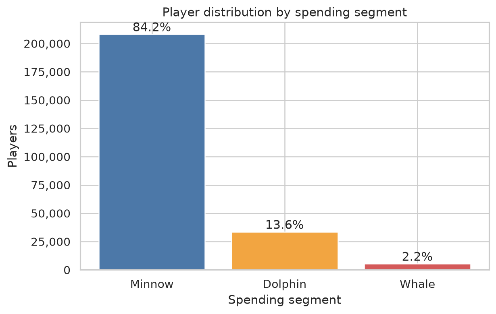
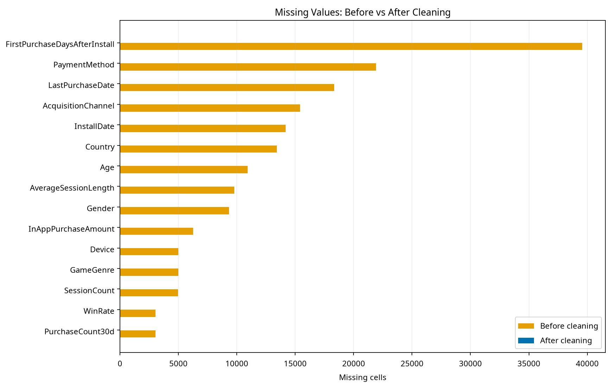

# 🎮 Mobile Game Player Spending Segmentation

### Player Intelligence · CDS4003 Data Science Project

### Turning player-behaviour data into smarter, more timely engagement

**A group data-science project exploring how mobile-game players can be classified as Minnows, Dolphins, or Whales to support more relevant player engagement.**

[Overview](#about-the-project) · [Dataset](#project-data) · [Workflow](#project-workflow)  · [Early findings](#visuals-and-early-findings) · [Team](#team)

---

## About the project

NovaPlay Studios is the business scenario for this project. Its marketing and live-operations teams want to understand player-spending segments before testing more relevant offers. A classifier may help prioritize those tests, but classification performance alone cannot prove that an offer increases revenue.

### Business question

> Can player-profile and gameplay information help identify a player's spending segment at a clearly defined prediction point, so the team can test more relevant engagement strategies?

**Business objective:** evaluate whether tailored campaigns can increase in-app-purchase (IAP) revenue by 15% within three months of deployment while protecting contribution margin and player retention. The 15% figure is a proposed target, not a result achieved by this project.

**Data-science question:** can the available player and gameplay features classify `SpendingSegment` as Minnow, Dolphin, or Whale? The prediction cutoff and a future outcome window must be confirmed before describing the task as an early prediction.

### Intended business value

- Identify player characteristics that may help shape testable offer hypotheses.
- Pay particular attention to Whale recall because Whales are a small share of the dataset.
- Measure campaign impact with a randomized holdout, comparing incremental IAP revenue, contribution margin, and retention. The classifier by itself does not establish business impact.

## Project status

**Current status: Stages 1–3 in progress.** Business formulation, dataset documentation, and data cleaning are documented. Exploratory data analysis and feature engineering are underway. Model development, model evaluation, and Streamlit deployment are not complete; no model performance or revenue lift is claimed.

## Project data

The source file contains **3,024 rows and 13 columns**. The project dataset was expanded to **250,000 rows and 23 columns** for the data-cleaning exercise. The additional records are synthetic and are not new Kaggle observations. After cleaning, the current output contains **247,500 rows and 23 columns**.

| Dataset | Access |
|---|---|
| Original Kaggle CSV · 3,024 rows × 13 columns | [Open original CSV](data/01_original_kaggle_data.csv) · [View Kaggle source](https://www.kaggle.com/datasets/pratyushpuri/mobile-game-in-app-purchases-dataset-2025) |
| Expanded dataset · 250,000 rows × 23 columns | [Download expanded dataset ZIP](data/02_expanded_dirty_data.zip) |
| Cleaned dataset · 247,500 rows × 23 columns | [Download cleaned dataset ZIP](data/03_clean_data.zip) |
| Data dictionary | [Open 01_data_dictionary.md](docs/01_data_dictionary.md) |
| Dataset search evidence | [Open 02_dataset_search_evidence.pdf](docs/02_dataset_search_evidence.pdf) |

The Kaggle listing describes its dataset as synthetic. The original source and the team's additional synthetic records are kept distinct throughout the project.

## Project workflow

1. **Business understanding** — define the NovaPlay Studios problem, business goal, target segments, and success measures.
2. **Data collection and generation** — review the Kaggle source, document its suitability, and prepare the project dataset. Start with [01_data_generation.ipynb](notebooks/01_data_generation.ipynb).
3. **Data cleaning** — inspect quality issues, remove exact duplicates, standardize formats, validate ranges, and export the cleaned dataset. See [02_data_cleaning.ipynb](notebooks/02_data_cleaning.ipynb).
4. **EDA and feature engineering** — compare player segments with statistics and visuals, then create interpretable 30-day per-active-day features.
5. **Model development and evaluation** — planned. Compare suitable multiclass models using macro-F1, balanced accuracy, per-class precision/recall, and a confusion matrix.
6. **Business interpretation and deployment** — planned. Test campaign strategies with a holdout before considering a Streamlit demonstration or deployment.

## Visuals and early findings

The cleaned file has **247,500 rows and 23 columns**. The spending-segment distribution is **84.17% Minnow, 13.60% Dolphin, and 2.22% Whale**. This class imbalance means accuracy alone would be misleading; Whale recall and macro-F1 should be reported during modeling.

Initial EDA shows only small differences across the current 30-day behavioural measures. Treat these patterns as hypotheses to test, not evidence that a particular behaviour causes spending. No model results or campaign revenue impact have been established yet.

## Team

| Member | Student ID / GitHub | Main contribution |
|---|---|---|
| [Hessa Khalfan](https://github.com/HesKal) | H00535166 · [@HesKal](https://github.com/HesKal) | Business problem formulation and dataset preparation; contributed to validation and quality visualizations. |
| [Nourah Abdulla](https://github.com/NourahAlghfeli) | H00535834 · [@NourahAlghfeli](https://github.com/NourahAlghfeli) | Data understanding and cleaning; quality checks and cleaned-dataset review. |
| [Maryam Ali Bin Hamdah](https://github.com/MaryamBinHamdah) | H00535836 · [@MaryamBinHamdah](https://github.com/MaryamBinHamdah) | cleaning, Dataset search and selection; source, suitability, and Data dictionary. |

## License and attribution

The team's original code is licensed under the [MIT License](LICENSE). The Kaggle dataset and third-party materials remain subject to their respective licenses and terms.

*Built by the CDS4003 project team · Work in progress*

